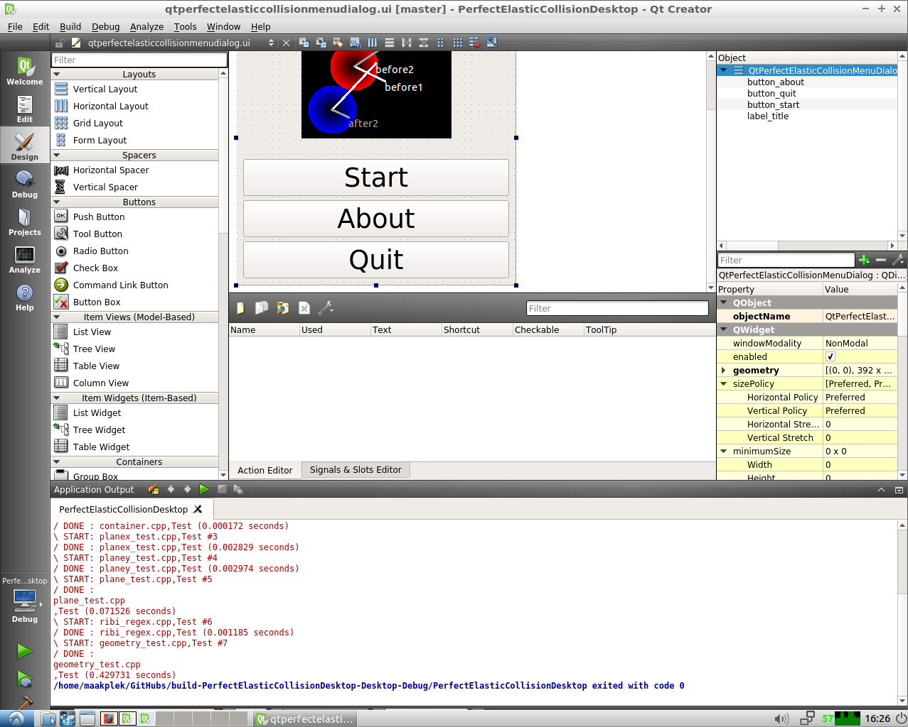
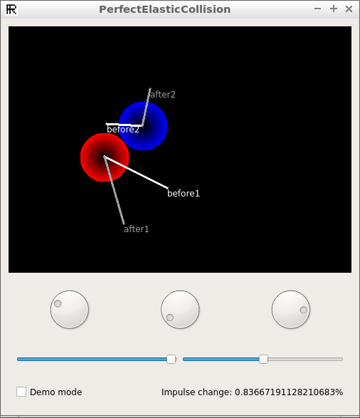

# PerfectElasticCollision

[Go to the nicely rendered
website](https://richelbilderbeek.github.io/PerfectElasticCollision/).

C++ tool to demonstrate a perfect elastic collision between two globes.

