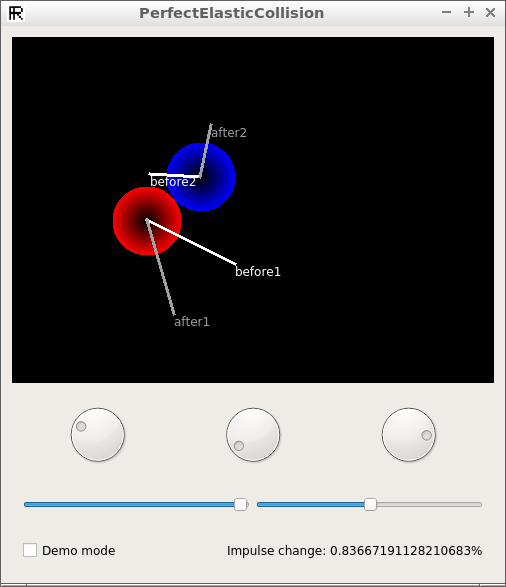

# PerfectElasticCollision

Experiment with perfect elastic collision impulses.

PerfectElasticCollision is one of [Richèl Bilderbeek's
tools](https://richelbilderbeek.github.io/tools/).

[Run it in your browser](play.md).

## Links

- [Source code](https://github.com/richelbilderbeek/PerfectElasticCollision)
- [Richèl Bilderbeek's tools](https://richelbilderbeek.github.io/tools/)
